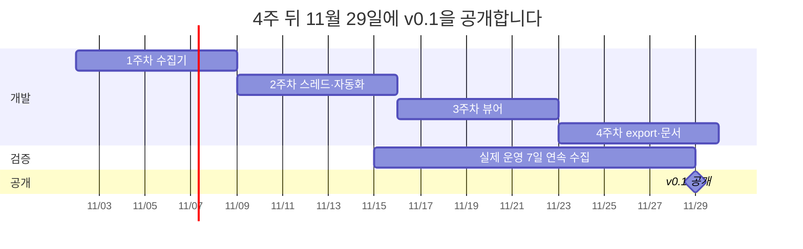
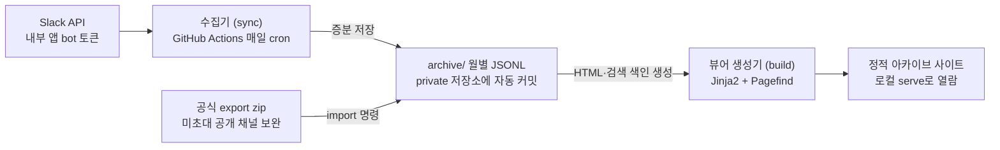

# Slack 무료 워크스페이스 자동 아카이브 프로젝트 기획서

작성일: 2026-10-30

## 1. 프로젝트 주제

Slack 무료 워크스페이스의 대화를 매일 자동으로 백업하고, 검색 가능한 정적 웹 아카이브로 보여 주는 셀프 호스팅 오픈소스 도구입니다.

- **형태**: CLI와 GitHub Actions 워크플로 템플릿
- **사용 방식**: 사용자가 자기 워크스페이스에 내부용 Slack 앱을 만들고, 그 봇 토큰으로 자기 private GitHub 저장소에서 실행
- **대상**: 개인 개발자와 스터디, 동아리, 오픈소스 커뮤니티 같은 소규모 단체. 운영자가 곧 워크스페이스 관리자인 곳
- **대상 아님**: 회사 워크스페이스. 앱 승인, 데이터 반출 정책, 감사 요구가 있는 환경은 지원 범위에서 제외
- **프로젝트 이름**: slackattic (Slack 공식 제품이 아니며 Slack과 무관함을 README에 명시, 마켓플레이스 등록 시 "Attic for Slack" 형태로 변경)

## 2. 프로젝트 기한

2026년 11월 2일부터 4주 동안 진행하고, 2026년 11월 29일에 v0.1을 GitHub에 공개합니다.

1. **1주차 수집기 (11/2 ~ 11/8)**: 내부 앱 manifest와 생성 가이드, 채널·사용자 목록, 메시지 증분 수집, 429 재시도, 상태 파일, Pagefind 한국어 검색 품질 검증
2. **2주차 스레드·자동화 (11/9 ~ 11/15)**: 스레드 수집과 변경 감지 재확인, GitHub Actions cron 템플릿, 설정 파일. 주말에 테스트 워크스페이스에서 실제 운영 시작
3. **3주차 뷰어 (11/16 ~ 11/22)**: 채널·날짜별 페이지, 멘션·링크·이모지 변환, 검색, `serve` 명령
4. **4주차 export·문서 (11/23 ~ 11/29)**: 공식 export zip 가져오기, README와 스크린샷, 테스트, 릴리스

"7일 연속 무오류" 완료 기준을 맞추려면 늦어도 11/22에는 cron이 실제 워크스페이스에서 돌고 있어야 하므로, 2주차 끝(11/15)에 실제 운영을 시작합니다.

## 3. 프로젝트 배경

Slack 무료 플랜에서는 대화가 90일이 지나면 보이지 않고, 1년이 지나면 영구 삭제됩니다. 스터디, 동아리, 오픈소스 커뮤니티처럼 유료 전환이 어려운 팀은 결정 기록과 자료를 그대로 잃게 됩니다.

- **90일 제한**: 무료 플랜은 최근 90일의 메시지와 파일 기록만 볼 수 있고, API로도 90일 이전 데이터는 받을 수 없습니다. ([Slack 도움말](https://slack.com/help/articles/27204752526611-Manage-your-free-workspace))
- **1년 후 영구 삭제**: 2024년 8월 26일부터 1년이 지난 메시지와 파일을 순차적으로 삭제하며, 삭제된 데이터는 복구할 수 없습니다. ([Slack 공지](https://slack.com/intl/en-in/help/articles/29414264463635-Updates-to-message-and-file-history-on-free-workspaces))
- **무료 내보내기의 한계**: 공개 채널만 내보낼 수 있고, 파일은 최근 90일 것의 링크만 주며, 관리자가 매번 수동으로 받아야 합니다. ([Slack 도움말](https://slack.com/help/articles/201658943-Export-your-workspace-data))
- **수요 근거**: 가장 널리 쓰이는 오픈소스 도구 slackdump에서도 "정기적으로 바뀐 것만 백업하고 싶다"는 요구가 반복됩니다. GitHub Actions로 정기 백업을 돌리려다 막힌 이슈에 댓글이 33개 달렸고([#404](https://github.com/rusq/slackdump/issues/404)), 사용자가 직접 증분 백업 스크립트를 만들어 공유하기도 했습니다([Discussion #193](https://github.com/rusq/slackdump/discussions/193)). 특정 채널을 계속 아카이브하는 방법을 묻는 질문은 아직 답이 없습니다([Discussion #631](https://github.com/rusq/slackdump/discussions/631)).

## 4. 프로젝트 목표

4주 안에 "한 번 설치하면 매일 알아서 쌓이고, 브라우저에서 검색되는" v0.1을 GitHub에 공개하는 것이 목표입니다.

**기능 목표 (MVP)**

1. 봇이 초대된 공개·비공개 채널의 메시지와 스레드를 매일 증분 수집
2. 수집한 데이터를 private 저장소에 JSONL로 자동 커밋
3. 채널·날짜별 페이지와 전문 검색이 되는 정적 뷰어 생성
4. Slack 공식 내보내기 zip 가져오기 (봇이 초대되지 않은 공개 채널의 최근 90일 보완)

**완료 기준**

- [ ] README만 보고 처음 쓰는 사람이 30분 안에 설치 완료
- [ ] 테스트 워크스페이스에서 7일 연속 자동 수집 무오류
- [ ] 같은 메시지가 중복 저장되지 않음: `(channel, ts)`를 키로 저장하고, 새 메시지가 없으면 재실행해도 git diff가 생기지 않음
- [ ] GitHub에 v0.1 릴리스와 데모 스크린샷 게시

첨부 파일 백업, 메시지 수정·삭제 추적, DM 백업은 2차 범위로 미룹니다.

## 5. 기존 서비스와 한계

지금 있는 방법은 돈을 내거나, 수동으로 반복하거나, 개인 로그인 세션에 의존해야 합니다. 공식 앱 권한으로 사람 손 없이 계속 쌓이는 선택지가 비어 있습니다.

| 방법 | 방식 | 한계 |
| --- | --- | --- |
| Slack 공식 내보내기 (무료) | 관리자가 zip을 수동 다운로드 | 공개 채널만, 파일은 90일치 링크만, 매번 수동, 검색 뷰어 없음 |
| 유료 플랜 업그레이드 | 기록 보존 | 인원당 월 과금이라 소규모 커뮤니티에 부담 |
| 유료 SaaS (ViewExport 등) | 백업 + 검색 UI | 유료, 대화 데이터를 외부 서버에 맡김 |
| [slackdump](https://github.com/rusq/slackdump) (오픈소스 CLI) | 사용자 세션(브라우저 로그인·쿠키)으로 수집, `resume`으로 증분, 내장 뷰어·정적 HTML | 아래 참고 |
| 개인 백업 스크립트 | API 직접 호출 | 코딩이 필요하고 설치·운영 문서가 부족 |

**slackdump와 비교** (이슈 247개, Discussions 55개 확인, 2026-10-30 기준)

slackdump는 증분 수집, 스레드 재확인(`-lookback`), 내장 뷰어, 정적 HTML, DM·첨부 파일·캔버스까지 이미 갖춘 성숙한 도구입니다. 다만 무인으로 계속 돌리는 용도에는 구조적인 약점이 남아 있습니다.

- **로그인과 인증**: 사용자 세션 방식이라 브라우저 호환성 문제가 반복되고([#725](https://github.com/rusq/slackdump/issues/725), [#675](https://github.com/rusq/slackdump/issues/675)), 회사 워크스페이스에서 계정이 정지되거나 의심 활동으로 로그아웃된 사례가 있습니다([#596](https://github.com/rusq/slackdump/issues/596), [Discussion #526](https://github.com/rusq/slackdump/discussions/526)).
- **무인 실행**: GitHub Actions에서 돌리려면 로컬에서 만든 세션 파일을 외부 저장소에 두고 암호화를 꺼야 하며, 세션이 만료되면 사람이 다시 로그인해야 합니다([#404](https://github.com/rusq/slackdump/issues/404)).
- **매일 실행 시 저장소 증가**: `resume`이 같은 메시지를 매번 다시 저장해 DB가 계속 커지고([Discussion #575](https://github.com/rusq/slackdump/discussions/575)), 대용량 DB 성능 문제가 아직 열려 있습니다([#633](https://github.com/rusq/slackdump/issues/633)).

**이 프로젝트의 차별점**

1. **공식 봇 토큰**: 브라우저 로그인, 세션 만료, 보안 경고, 계정 정지 위험이 없음. 관리자가 정식으로 승인하는 방식
2. **설치 후 손댈 일 없음**: Actions 템플릿과 Secret 하나로 매일 자동 수집, 봇이 초대된 채널은 자동으로 수집 대상에 포함
3. **불어나지 않는 저장**: `(channel, ts)` 키로 덮어써 git 이력에는 실제 변경만 남음
4. **비개발자 운영자용 문서**: 한국어 단계별 가이드와 설정 검사 명령(`doctor`)

**slackdump가 더 맞는 경우**: 회사 워크스페이스, DM 백업, 첨부 파일·캔버스 보관, 수십 GB 규모 워크스페이스, Mattermost 등으로 이전. README에서 이 경우 slackdump를 안내합니다.

**인증 방식에 따른 보안 차이**: slackdump는 사람의 브라우저 세션을 빌려 Slack 웹 클라이언트를 흉내 내므로 의심 로그인으로 탐지될 수 있습니다. 이 프로젝트는 워크스페이스에 정식 설치된 앱의 봇 토큰으로 허용된 권한 안에서만 API를 호출하므로 이런 탐지 대상이 아니고, 개인 계정과 무관해 계정 정지나 세션 만료도 없습니다.

## 6. 기술 스택

Python과 GitHub Actions만으로 서버나 DB 없이 무료로 돌아가게 구성합니다.

| 영역 | 선택 | 이유 |
| --- | --- | --- |
| 언어 | Python 3.12 | Slack 공식 SDK가 있고 스크립트형 도구를 빠르게 만들 수 있음 |
| Slack 연동 | slack_sdk (Web API) | 페이지네이션과 429 재시도 처리 지원 |
| 저장 | 월별 JSONL 파일 + git (private 저장소) | 서버·DB 없이 무료, 변경 이력이 자동으로 남음 |
| 자동 실행 | GitHub Actions cron | 무료, 사용자는 토큰만 Secret에 등록 |
| 뷰어 생성 | Jinja2로 정적 HTML 생성 | 구조가 단순하고 어디서나 열림 |
| 검색 | Pagefind | 정적 사이트용 전문 검색, 서버 불필요. 한국어 어간 처리를 지원하지 않아 1주차에 검증하고, 부족하면 n-gram 색인이나 FlexSearch로 교체 |
| CLI·패키징 | Typer + uv | `sync`, `import`, `build`, `serve`, `doctor` 명령 구성 |
| 테스트 | pytest + 녹화한 API 응답 | 실제 Slack 없이 동일한 결과로 재현 |

매일 cron이 수집기를 돌려 새 메시지만 저장하고, 봇이 들어가지 않은 공개 채널은 공식 export로 보완합니다. 뷰어는 저장된 JSONL로 만들어 내 컴퓨터에서만 엽니다.

**스레드 재확인 방식**: 최근 N일 메시지를 `conversations.history`로 다시 받아 부모 글의 `reply_count`와 `latest_reply`를 상태 파일과 비교하고, 바뀐 스레드만 `conversations.replies`로 다시 받습니다. 모든 부모 글을 매번 조회하면 호출 한도에 바로 걸리기 때문입니다.

## 7. 발생 가능한 한계

가장 큰 한계는 "설치 이전의 90일을 넘긴 기록은 되살릴 수 없다"는 점이고, 이는 README 첫 문단에 밝힙니다. 공식 export도 같은 90일 범위만 담으므로 과거 기록을 되살리는 수단이 아닙니다.

| 한계 | 원인 | 대응 |
| --- | --- | --- |
| 과거 기록 복구 불가 | 무료 플랜은 API와 공식 export 모두 최근 90일만 제공 | "지금부터 쌓는 도구"로 안내, export 가져오기는 미초대 공개 채널 보완용으로 한정 |
| API 호출 한도 | 마켓플레이스 밖 배포형 앱은 `conversations.history`와 `conversations.replies`가 분당 1회·15개로 제한됨. 내부 앱은 요청당 1,000개·분당 50회 이상 유지 ([Slack FAQ](https://api.slack.com/changelog/2025-05-terms-rate-limit-update-and-faq)) | 사용자가 내부 앱을 직접 만드는 구조로 고정, 앱 manifest 파일로 생성을 간단하게 |
| 스레드 재확인 호출량 | 활발한 워크스페이스에서는 부모 글이 많아 `conversations.replies` 호출이 한도를 넘음 | `reply_count`·`latest_reply` 변경 감지로 바뀐 스레드만 조회 |
| 설치 장벽 | 앱 생성, 권한 설정, 토큰·Secret 등록을 사용자가 직접 해야 함 | 단계별 스크린샷 README, 설정 검사 명령(`doctor`) |
| 무료 플랜 앱 개수 제한 | 무료 플랜은 연동 앱이 10개로 제한되며, 내부 앱도 이 개수에 포함됨 | README 설치 가이드 첫 단계에서 남은 앱 슬롯을 확인하도록 안내, 앱 하나로 모든 기능을 처리해 슬롯을 1개만 사용 |
| 수집 범위 | bot 토큰은 초대된 채널만 읽음, DM 제외 | `channels:join` 권한으로 공개 채널은 자동 참여, 비공개 채널은 초대 안내, DM은 2차 범위 |
| 수정·삭제 미반영 | MVP는 추가된 메시지만 저장. API는 수정 전 원문을 주지 않음 | 2차 범위에서 이전 저장본과 비교하는 방식으로만 추적 |
| 재확인 중 수정된 메시지 | 스레드를 다시 받을 때 수정된 메시지가 섞여 들어옴 | `(channel, ts)` 키로 최신 내용으로 덮어쓰는 규칙으로 통일 |
| 한국어 검색 품질 | Pagefind는 한국어 어간 처리를 지원하지 않아 "회의"로 "회의를"을 못 찾을 수 있음 | 1주차 검증, 부족하면 n-gram 색인이나 다른 검색 라이브러리로 교체 |
| 개인정보와 동의 | 비공개 채널 대화를 외부(GitHub)에 저장함 | 채널 구성원 고지·동의 안내, README에 개인정보보호법 관련 주의 문구 |
| 보안 | 토큰과 대화 내용이 GitHub에 저장됨. 봇 토큰이 유출되면 초대된 모든 채널을 읽을 수 있음 | 읽기 전용 최소 권한, 토큰은 Actions Secret에만 저장, private 저장소 필수(`doctor`로 확인), 뷰어는 공개 Pages 대신 로컬 실행 |
| 회사 워크스페이스 사용 | 무료 플랜을 쓰는 작은 회사도 설치할 수 있으나, 회사 대화를 개인 저장소에 두면 사내 보안 정책 위반이 될 수 있음 | 지원 대상에서 제외하고 README에 "회사 워크스페이스는 관리자 승인과 보안 정책을 먼저 확인" 문구 명시 |
| 저장소 용량·Actions 사용량 | 대화가 많으면 git 저장소가 커지고 매일 실행 시간이 쌓임 | 월별 JSONL 분할, 첨부 파일 제외, 대규모 워크스페이스는 대상에서 제외하고 slackdump 안내 |
| Slack 정책 변경 | 2025년에도 호출 한도가 바뀜 | API 호출부를 한 모듈로 모아 변경에 빠르게 대응 |
| 일정 | 1인 4주 개발 | 뷰어는 최소 기능부터, 밀리면 export 가져오기를 v0.2로 |
